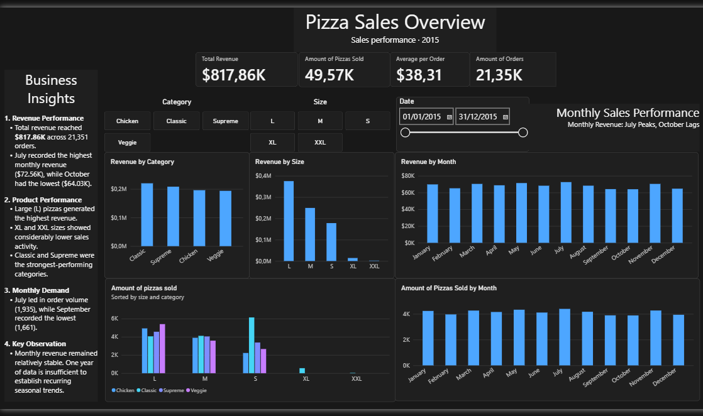
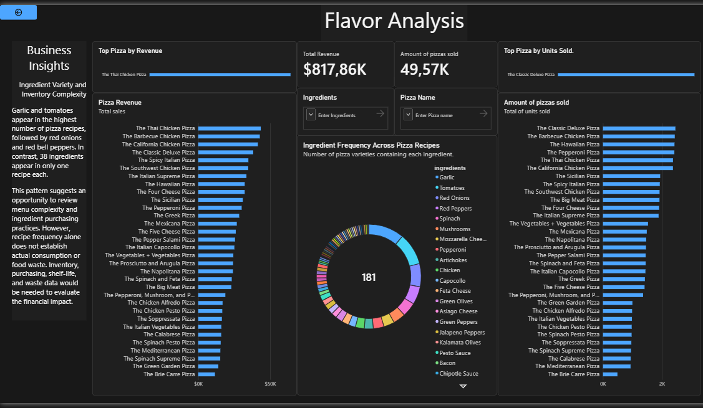
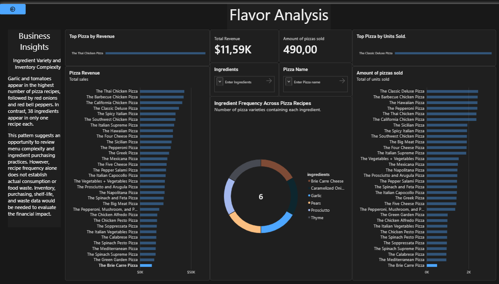
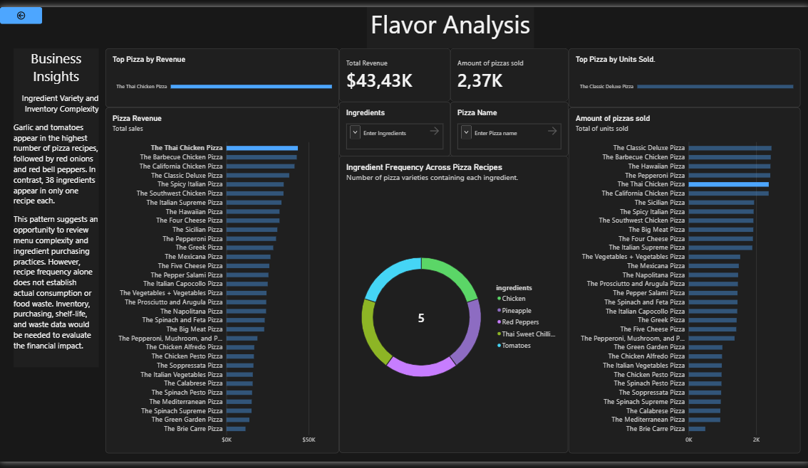
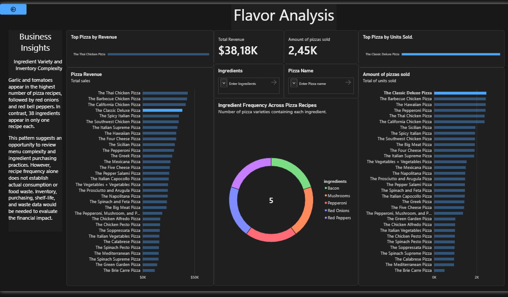
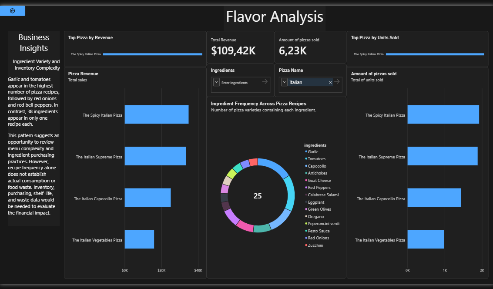
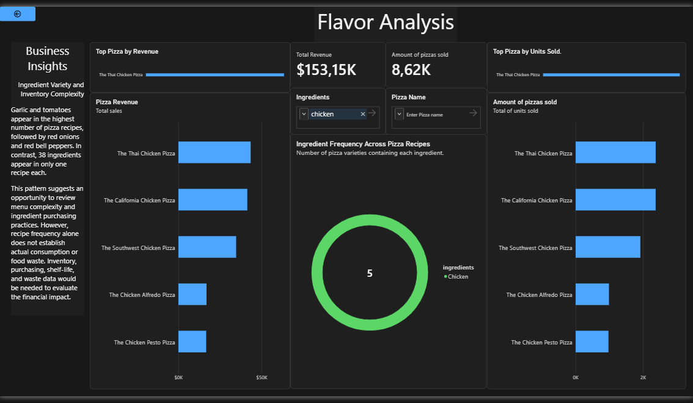

# Pizza Sales Analysis | Power BI

## Project Overview

This project analyzes pizza sales data using Power BI to identify sales trends, evaluate product performance, and explore recipe composition.

The interactive report provides insights into revenue, order volume, product performance, and ingredient frequency across different pizza varieties.

## Tools & Technologies

- **Power BI** – Dashboard development and data visualization.
- **Power Query** – Data preparation, cleaning, and transformation.
- **DAX** – Measures and analytical calculations.
- **Data Modeling** – Relationships between orders, sales details, pizzas, and pizza types.
- **Excel** – Source data organization and preparation.

## Data Source and Preparation

The dataset used in this project is **Pizza Place Sales**, provided by [Maven Analytics Data Playground](https://mavenanalytics.io/data-playground).

The original dataset consists of five CSV files:

- `data_dictionary.csv` – Dataset documentation and field descriptions.
- `order_details.csv` – Individual pizza items associated with each order.
- `orders.csv` – Order dates and times.
- `pizza_types.csv` – Pizza names, categories, and ingredients.
- `pizzas.csv` – Pizza sizes, IDs, and prices.

Before importing the data into Power BI, I organized the source files in an Excel workbook (`pizza_sales_preparation.xlsx`). I converted the data ranges into structured Excel tables and arranged the worksheets to make the relationships between datasets easier to review.

Power Query was used for data cleaning, transformation, and analytical preparation, while Power BI was used for data modeling, DAX calculations, and interactive visualization.

## Dashboard Pages

### 1. Pizza Sales Overview

An overview of the business's sales performance, including:

- Total revenue
- Total pizzas sold
- Total orders
- Average order value
- Monthly sales and revenue trends
- Revenue by pizza category and size
- Sales performance across product sizes and categories

### 2. Flavor Analysis

A deeper analysis of product performance and recipe composition, including:

- Revenue comparison across pizza varieties
- Top-selling pizzas by revenue
- Top-selling pizzas by units sold
- Ingredient frequency across pizza recipes
- Interactive ingredient and pizza filters

## Exploratory Analysis

Additional explorations were conducted to investigate specific product groups and identify patterns across the menu.

These include:

- Bottom-performing pizza varieties
- Top pizzas by revenue
- Top pizzas by units sold
- Ingredient exploration across chicken pizzas
- Ingredient exploration across Italian pizzas

These explorations demonstrate how the data model can be used to investigate different business questions and product segments.

## Key Business Insights

- Total revenue reached **$817,860.05** across **21,351 orders**.
- A total of **49,574 pizzas** were sold.
- July recorded the highest monthly revenue, while October recorded the lowest.
- Large pizzas generated the highest revenue among size categories.
- The Thai Chicken Pizza generated the highest revenue, while the Classic Deluxe Pizza sold the most units.
- Garlic and tomato were the most frequently occurring ingredients across pizza recipes, appearing in 20 and 18 varieties, respectively.

## Project Objective

The goal of this project was to transform raw sales data into an interactive analytical report that makes business performance easier to understand and supports data-driven decision-making.

## Screenshots

Screenshots of the main dashboard pages and additional exploratory analyses are included in this repository.

### Pizza Sales Overview

### Flavor Analysis

### Exploratory Analysis

##### Bottom Pizza Exploration

##### Top Pizza By Revenue

##### Top Pizza By Units Sold

##### Italian Pizzas Exploration

##### Chicken Ingredient Exploration

## Notes

- Revenue represents sales generated, not profit. Production costs and operating expenses were not available in the dataset.
- Ingredient frequency represents the number of pizza varieties containing each ingredient. It does not represent the actual quantity consumed or purchased.
- The dataset covers 2015, so the analysis does not establish recurring seasonal patterns across multiple years.
